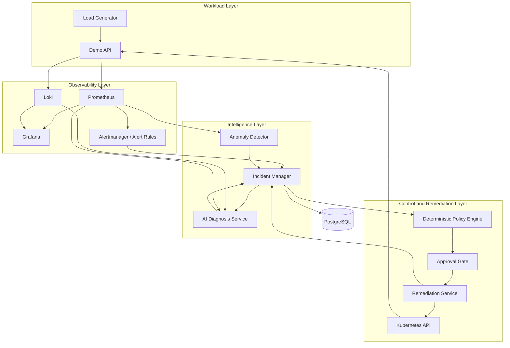

# MinOps — Technical Project Documentation

**Working title:** AI-Powered Intelligent Infrastructure Operations Platform  
**Repository:** <https://github.com/k6gnn/MinOps>  
**Documentation status:** Project design and implementation specification  
**Last updated:** 3 November 2026  
**Current implementation stage:** Phase 1 complete (demo API with fault-simulation switch, structured logging, automated tests and pinned dependencies). Phase 2 in progress: a hardened multi-stage Dockerfile exists; reproducible-build and container validation are still to be done

> **Status and accuracy note**  
> This document describes the intended design, architecture, requirements, and implementation roadmap for MinOps. It is not a claim that the platform or its planned components already exist. Unless a section explicitly says otherwise, features described below are proposed or planned. The implementation should be updated incrementally, and this document should be revised whenever an architectural decision changes.

---

# 1. Executive Summary

MinOps is a learning-oriented, cloud-native infrastructure operations platform intended to combine DevOps, site reliability engineering (SRE), observability, machine learning operations (MLOps), and carefully controlled AI-assisted incident response.

The platform is intended to monitor containerized applications and their Kubernetes environment, detect unusual behaviour in operational metrics, assemble useful evidence from metrics and logs, generate an understandable incident diagnosis, recommend remediation, and execute only actions that pass deterministic safety and authorization checks. Following an approved action, MinOps should verify whether the system recovered and retain an auditable incident record.

The central idea is to connect several operational capabilities into one understandable workflow:

1. **Observe:** collect application and infrastructure metrics, logs, and health information.
2. **Detect:** identify suspicious or abnormal behaviour using thresholds, rules, and eventually machine-learning models.
3. **Correlate:** associate alerts with relevant workloads, time windows, metrics, and logs.
4. **Diagnose:** use an AI component to summarize evidence and explain plausible causes, uncertainty, and next steps.
5. **Decide safely:** pass proposed actions through a deterministic policy and authorization layer.
6. **Remediate:** execute a narrowly defined, allowlisted Kubernetes operation only when policy permits it and any required approval is present.
7. **Verify:** observe the workload after the action and determine whether the expected recovery occurred.
8. **Learn and audit:** store the incident, evidence references, decisions, actions, verification results, and model information.

MinOps is not intended to give a language model unrestricted access to a cluster. The LLM is an analysis and recommendation component; it is not the authority that decides which operations may run. Kubernetes access belongs to a separate, constrained remediation service that validates requests against explicit policies.

The project will be developed incrementally. It should begin with a small local demo application and a local Kubernetes environment. Observability and incident data collection will be added before machine learning and AI diagnosis. Automated remediation will be introduced only after detection, evidence collection, authorization, and verification are independently testable.

## 1.1 Project vision

Create a demonstrable platform that can recognize a controlled application failure, explain it using operational evidence, recommend a safe response, carry out an approved action, and verify the result.

## 1.2 Intended audience

The project is primarily intended as:

- A substantial engineering learning project.
- A portfolio demonstration for DevOps, Cloud Engineering, Platform Engineering, SRE, and MLOps roles.
- A practical environment for learning Kubernetes, observability, infrastructure automation, APIs, machine learning, and safe AI integration.
- A foundation for experiments with intelligent incident response and self-healing infrastructure.

It is not initially designed as a production-ready replacement for established monitoring, alerting, incident-management, or orchestration platforms.

## 1.3 Guiding principle

**Automation must be explainable, bounded, reversible where possible, and verified.** A diagnosis is not proof of a root cause. A recommendation is not authorization. A successful API response is not proof of recovery.

---

# 2. Problem Statement and Motivation

Containerized applications can fail in ways that are visible across several different operational signals. For example, a web service may begin returning HTTP 500 responses while request latency, CPU usage, memory use, and error logs change at the same time.

A conventional monitoring stack can expose metrics and trigger alerts, but an operator may still need to:

- Identify which service and deployment are affected.
- Determine when the abnormal behaviour started.
- Examine relevant metrics and logs around the incident.
- Distinguish a symptom from a likely cause.
- Decide whether a restart, scaling operation, rollback, or manual investigation is appropriate.
- Carry out the operation safely.
- Confirm that the service recovered and did not immediately fail again.
- Record what happened and why a particular action was taken.

MinOps explores how these steps can be connected and partially assisted by machine learning and language models without removing deterministic operational safeguards.

## 2.1 Example problem scenario

A demo API deployed in Kubernetes begins returning HTTP 500 responses. At approximately the same time:

- The HTTP error rate rises.
- Request latency increases.
- CPU consumption becomes abnormal.
- Application logs contain repeated exception events.
- A health or readiness check may begin failing.

A basic alert can report that the error rate crossed a threshold. MinOps should eventually be able to add context: the affected service, the relevant time window, the metric changes, related logs, and recent workload state. Its diagnosis component may conclude that the evidence is consistent with a particular failure mode, while stating uncertainty and citing the signals that support the conclusion.

A policy engine then evaluates whether a proposed action is permitted. For a controlled demonstration, a restart of a specific deployment might be permitted after approval. The remediation service performs the narrowly scoped operation through the Kubernetes API. MinOps subsequently checks readiness, error rate, and latency to decide whether recovery occurred.

The platform should not automatically restart a service merely because an LLM says to do so. The policy engine must independently validate the target, action, scope, limits, cooldown, approval requirement, and current state.

## 2.2 Project objectives

The project should demonstrate the ability to:

1. Deploy and operate a containerized workload on Kubernetes.
2. Collect useful application and infrastructure telemetry.
3. Visualize system health and operational trends.
4. Detect known failure conditions through rules and abnormal behaviour through an ML model.
5. Correlate metric anomalies with logs and workload metadata.
6. Create structured incidents with a timeline and supporting evidence.
7. Generate AI-assisted diagnoses that separate observed facts from hypotheses.
8. Enforce remediation rules independently of AI-generated recommendations.
9. Execute a limited set of Kubernetes actions with least-privilege access.
10. Verify post-action recovery using measurable conditions.
11. Persist incident history and provide an audit trail.
12. Test the system using repeatable failure scenarios.
13. Build and deliver components through an automated CI/CD process.
14. Document architecture decisions, trade-offs, limitations, and evaluation results.

## 2.3 Non-goals for the initial project

The initial versions will not attempt to:

- Support every Kubernetes distribution or cloud provider.
- Operate a large production cluster.
- Replace Prometheus, Grafana, Loki, Kubernetes, or a full incident-management suite.
- Allow an LLM to execute arbitrary shell commands.
- Allow an LLM to access Kubernetes credentials directly.
- Automatically remediate every possible failure.
- Guarantee that an ML anomaly score identifies a root cause.
- Guarantee that an LLM diagnosis is factually correct.
- Run a large language model locally on the development machine.
- Deploy expensive cloud infrastructure before the local workflow is stable.

---

# 3. Product Scope and Functional Requirements

## 3.1 Core functional capabilities

| ID | Capability | Planned behaviour | Priority |
|---|---|---|---|
| FR-01 | Workload monitoring | Observe the demo application and its Kubernetes workload | Essential |
| FR-02 | Metrics collection | Collect application and infrastructure measurements | Essential |
| FR-03 | Log collection | Collect structured application logs and make them searchable | Essential |
| FR-04 | Health monitoring | Observe liveness, readiness, and workload state | Essential |
| FR-05 | Rule-based alerts | Detect known conditions such as sustained HTTP 5xx rates | Essential |
| FR-06 | ML anomaly detection | Score metric windows for unusual behaviour | Planned |
| FR-07 | Incident creation | Create a structured incident from an alert or detector event | Essential |
| FR-08 | Evidence correlation | Attach relevant metrics, logs, and workload metadata to incidents | Planned |
| FR-09 | AI diagnosis | Produce a structured explanation and bounded recommendations | Planned |
| FR-10 | Policy validation | Validate action type, target, scope, permissions, and safety constraints | Essential before remediation |
| FR-11 | Approval workflow | Require human approval for configured actions | Essential before remediation |
| FR-12 | Kubernetes remediation | Execute explicitly supported actions through the Kubernetes API | Planned |
| FR-13 | Recovery verification | Evaluate defined recovery conditions after an action | Essential before claiming self-healing |
| FR-14 | Incident history | Persist incident events, decisions, actions, and results | Planned |
| FR-15 | CI/CD | Test and package project components automatically | Planned |
| FR-16 | Security checks | Scan dependencies and container images and validate access controls | Planned |

## 3.2 Non-functional requirements

### Reliability

- Components should expose health checks where appropriate.
- Transient failures in external services should not crash unrelated components.
- Incident processing should tolerate duplicate notifications.
- Remediation should be idempotent where practical.
- A failure in the AI provider must not disable the policy engine or basic rule-based incident handling.

### Security

- Services should use least-privilege identities.
- Kubernetes credentials must not be included in source control, container images, or logs.
- Secrets must be injected through an appropriate secret-management mechanism.
- The LLM must not receive credentials or unrestricted cluster access.
- Remediation targets and actions must be allowlisted and validated.
- Approval and action outcomes must be auditable.

### Maintainability

- Keep the initial architecture modular without prematurely creating many microservices.
- Separate application code, infrastructure configuration, model logic, and tests.
- Use consistent naming and structured logs.
- Document non-obvious decisions and operational assumptions.

### Portability

- The first environment should run locally.
- Kubernetes manifests and Helm packaging should avoid unnecessary dependence on one cloud provider.
- Cloud-specific infrastructure should be isolated under provider-specific directories.

### Resource efficiency

- Keep local components lightweight.
- Add observability services gradually.
- Configure retention for metrics and logs.
- Measure memory and CPU use before increasing the number of simultaneously running services.

### Explainability

- Anomaly events should include the relevant features and time window.
- AI diagnoses should identify supporting evidence and uncertainty.
- Policy decisions should explain why an action was allowed or rejected.
- Recovery verification should report the exact conditions evaluated.

---

# 4. System Architecture

## 4.1 High-level architecture

The intended platform is divided into five logical layers:

1. **Workload layer:** the demo API and any later sample applications.
2. **Observability layer:** metric, log, and alert collection.
3. **Intelligence layer:** anomaly detection, incident correlation, and AI-assisted diagnosis.
4. **Control and remediation layer:** deterministic policy evaluation, approval, and constrained Kubernetes operations.
5. **Persistence and interface layer:** incident history, API endpoints, dashboards, and audit information.

The separation is logical. Early implementations may combine multiple responsibilities within one deployable service. Components should only be split into independent services when there is a clear operational or learning reason.

## 4.2 Conceptual component diagram



This diagram shows intended relationships, not an implemented deployment manifest. Exact data transport mechanisms and component boundaries may change as the project develops.

## 4.3 Component responsibility boundaries

| Component | Owns | Must not own |
|---|---|---|
| Demo API | Sample business endpoints, health endpoints, test failure scenarios, application telemetry | Cluster-wide monitoring or remediation |
| Load generator | Repeatable request patterns and controlled traffic | Production-like authority over the cluster |
| Prometheus | Time-series metric scraping, storage, and query | Root-cause certainty or remediation authorization |
| Grafana | Dashboards and visual exploration | Policy enforcement |
| Loki | Log ingestion and querying | Incident decisions by itself |
| Alertmanager / alert rules | Route and group known alert conditions | Arbitrary cluster mutations |
| Anomaly detector | Feature preparation, model inference, anomaly score and metadata | Direct Kubernetes operations |
| Incident manager | Incident lifecycle, evidence references, timeline, persistence, workflow coordination | Unrestricted AI or infrastructure execution |
| AI diagnosis service | Evidence-based explanation, confidence/uncertainty, bounded recommendations | Direct Kubernetes credentials or shell execution |
| Policy engine | Allow/deny decision based on deterministic rules | Free-form natural-language decision-making |
| Approval component | Capture required human authorization | Change the policy rules silently |
| Remediation service | Execute specific approved Kubernetes API operations | Arbitrary command execution or unbounded resource access |
| Verification logic | Evaluate post-action recovery conditions | Assume that an accepted API request means recovery |
| PostgreSQL | Durable incident and audit records | Store secrets or raw high-volume metrics unnecessarily |

## 4.4 Data-flow overview

### Normal operation

1. The demo API receives requests from the load generator or a user.
2. The application emits logs and exposes metrics.
3. Prometheus collects available metrics; Loki receives logs.
4. Grafana displays the health and performance signals.
5. The anomaly detector periodically evaluates configured metric windows once introduced.
6. The platform remains in a monitoring state when no incident condition is detected.

### Incident operation

1. A rule or detector identifies a condition that requires attention.
2. An incident event is created or an existing incident is updated.
3. The incident manager associates the event with a service, workload, time window, and evidence references.
4. The diagnosis service receives a bounded evidence package.
5. The diagnosis service returns a structured report containing observations, hypotheses, confidence, evidence references, and recommended next steps.
6. The policy engine evaluates any proposed action independently.
7. If policy requires approval, the action waits for an authorized approval decision.
8. The remediation service executes an approved and allowlisted operation through the Kubernetes API.
9. Verification checks the relevant health and performance signals during a defined observation window.
10. The incident manager stores the outcome and updates the incident state.

### Failure of a supporting component

- If the LLM provider is unavailable, the incident should still be recorded and rule-based information should remain available.
- If the anomaly detector is unavailable, conventional alert rules should continue to function.
- If PostgreSQL is unavailable, the system should avoid falsely reporting that an incident was durably recorded; it should apply a defined retry or degraded-mode strategy.
- If the remediation service is unavailable, the incident remains open and the failure is recorded. No alternative unsafe execution path should be attempted.

---

# 5. Technical Stack and Rationale

The stack below is the proposed learning stack. It is intentionally incremental. Tool versions should be selected and pinned when each phase is implemented, after checking the relevant official documentation and compatibility requirements.

## 5.1 Infrastructure and container platform

| Technology | Intended use | Reason for selection |
|---|---|---|
| Docker | Build and run application containers | Common container workflow and local development support |
| Docker Desktop | Local Docker environment on Windows | Provides a manageable Windows development workflow |
| WSL2 | Linux environment used by the local container setup | Supports Linux containers on Windows |
| k3d | Create a local Kubernetes cluster using Docker containers | Lightweight and suitable for a local learning cluster |
| k3s | Kubernetes distribution inside the k3d nodes | Lower resource overhead than a conventional full cluster distribution |
| kubectl | Kubernetes API client | Standard cluster administration and debugging interface |
| k9s | Terminal-based Kubernetes inspection | Faster interactive exploration of workloads and cluster state |
| Helm | Package and configure Kubernetes applications | Reusable and parameterized deployment definitions |

### Important terminology

- **Docker Desktop** is the local desktop environment that provides Docker functionality.
- **k3d** creates and manages a k3s cluster using Docker containers as nodes.
- **k3s** is the Kubernetes distribution running inside those nodes.
- A **server node** in k3s hosts control-plane responsibilities; an **agent node** joins as a worker.
- A Kubernetes **Pod** is the smallest deployable unit Kubernetes schedules. It commonly contains one application container, but may contain more.

The local k3d nodes are Docker containers, not separate physical servers or independent virtual machines. They share the host computer's underlying CPU, memory, storage, and network resources. Three local nodes are useful for learning scheduling and node behaviour, but do not provide true hardware or availability-zone redundancy.

## 5.2 Application and backend

| Technology | Intended use |
|---|---|
| Python | Backend services, automation, data processing, and ML integration |
| FastAPI | Demo API and later service APIs |
| Pytest | Unit, API, and integration tests |
| Pydantic | Request/response validation and structured data contracts |

## 5.3 Observability

| Technology | Intended use |
|---|---|
| Prometheus | Metrics scraping, time-series storage, and PromQL queries |
| Grafana | Metrics and log dashboards |
| Loki | Log aggregation and querying |
| OpenTelemetry | Consistent instrumentation and telemetry concepts; introduce when useful |
| Alertmanager | Alert grouping, routing, and notification handling |

Prometheus and Loki should initially be used as the operational sources of telemetry. PostgreSQL is for platform-owned incident and audit data, not a replacement for time-series or log storage.

## 5.4 Machine learning and AI

| Technology | Intended use |
|---|---|
| Pandas | Prepare and inspect time-series data |
| scikit-learn | Baseline anomaly detection experiments, including Isolation Forest |
| MLflow | Track experiments, parameters, metrics, and model artifacts |
| Hosted LLM API | Generate evidence-based incident summaries and recommendations |

The initial ML approach should favour a small, interpretable baseline over complex deep-learning models. Isolation Forest is a candidate, not a predetermined answer. A threshold-based baseline should be measured first so that ML adds demonstrable value rather than complexity for its own sake.

The initial development machine has 16 GB RAM. A large local LLM is therefore not part of the initial plan. A hosted model API or a lightweight alternative can be evaluated later, with attention to privacy, cost, latency, provider availability, and data minimization.

## 5.5 Delivery, security, and testing

| Technology | Intended use |
|---|---|
| GitHub Actions | Continuous integration and later delivery workflows |
| Trivy | Scan container images and relevant dependencies/configurations |
| Argo CD | GitOps deployment management when the deployment workflow is ready |
| Terraform | Define cloud infrastructure reproducibly |
| Chaos Mesh or controlled fault injection | Generate isolated, repeatable failure scenarios |

## 5.6 Persistence

PostgreSQL is the planned database for incidents, event timelines, policy decisions, remediation attempts, verification results, and audit information. It should not be used to duplicate large quantities of raw metrics and logs that are already retained by Prometheus and Loki.

---

# 6. Local Development Environment

## 6.1 Development host assumptions

The known development machine profile is:

- Windows 11.
- 16 GB RAM.
- SSD storage.
- Intel Core i7 processor; exact model and core count are not yet specified.
- Docker Desktop with WSL2 backend is the proposed local container environment.

This is enough for a carefully staged local implementation, but it is a constrained environment for running a full monitoring and AI platform simultaneously.

## 6.2 Initial local Kubernetes topology

The proposed learning cluster contains:

- One k3s server/control-plane node.
- Two k3s agent/worker nodes.

The purpose is to learn control-plane and worker responsibilities, scheduling, node failure behaviour, resource requests and limits, and workload placement.

### Approximate resource planning target

| Resource area | Initial planning estimate |
|---|---:|
| Total host RAM | 16 GB |
| Windows and background applications | Approximately 8 GB |
| Docker/Kubernetes working budget | Approximately 5 GB |
| Remaining headroom | Approximately 3 GB |
| Control-plane node planning target | Approximately 1.5 GB RAM |
| Worker node 1 planning target | Approximately 1.5 GB RAM |
| Worker node 2 planning target | Approximately 1.5 GB RAM |
| Total node memory planning target | Approximately 4.5 GB RAM |
| Combined node CPU planning target | Approximately 3–5 CPU cores |

These are planning figures, not guaranteed reservations or a promise that the complete future stack will fit. Actual consumption depends on Windows, Docker Desktop, WSL2, Kubernetes system components, workloads, and observability retention. Measure real usage and adjust the plan.

### Three different resource layers

Do not confuse these mechanisms:

1. **Host/WSL/Docker Desktop resource limits:** constrain the total resources available to the Linux/container environment.
2. **Node container limits:** constrain the CPU and memory available to an individual k3d node container, where configured.
3. **Kubernetes Pod requests and limits:** influence scheduling and enforce resource boundaries for application containers.

They solve different problems. Setting Pod requests does not reserve physical memory for a Docker node, and setting a Docker Desktop memory cap does not decide how Kubernetes schedules Pods.

### CPU and memory concepts

- A CPU request contributes to scheduling decisions and resource accounting. It is not an exclusive physical CPU reservation.
- A CPU limit constrains CPU time available to a container and can result in throttling.
- A memory request is used by the scheduler when evaluating placement.
- A memory limit is an enforced ceiling; exceeding it can lead to the container being terminated, commonly with an out-of-memory indication.
- Requests and limits should be based on observed application behaviour, not arbitrary numbers copied from another system.

## 6.3 Local cluster limitations

A three-node local cluster does not simulate independent hardware failure. All node containers depend on one host. If Windows, Docker Desktop, WSL2, or the host storage fails, the entire cluster may become unavailable.

The local environment is useful for development and controlled experiments, not for proving production high availability, disaster recovery, or cloud-scale performance.

## 6.4 Gradual component installation

Do not start every planned service at once. The suggested order is:

1. Demo API and its tests.
2. Docker image build and local container execution.
3. Kubernetes cluster and demo API deployment.
4. Prometheus and basic metrics.
5. Grafana dashboards.
6. Loki and structured log collection.
7. Alerting.
8. ML and incident services.
9. AI diagnosis and PostgreSQL.
10. Remediation and GitOps components.

Observe available RAM, CPU, and disk space after each addition. Configure log and metric retention with the host's capacity in mind.

---

# 7. Repository Organization

The repository is intended to grow incrementally. Do not create every planned directory before it has a real purpose.

## 7.1 Initial structure

The initial proposed structure is:

```text
MinOps/
├── applications/
├── services/
├── infrastructure/
├── monitoring/
├── ml/
├── tests/
├── docs/
└── .github/
    └── workflows/
```

## 7.2 Expanded target structure

The following is a possible later structure, not a requirement to create it all immediately:

```text
MinOps/
├── applications/
│   ├── demo-api/
│   │   ├── app/
│   │   └── tests/
│   └── load-generator/
│       └── tests/
├── services/
│   ├── anomaly-detector/
│   │   ├── training/
│   │   ├── inference/
│   │   ├── models/
│   │   └── tests/
│   ├── incident-manager/
│   │   ├── api/
│   │   ├── database/
│   │   └── tests/
│   ├── ai-diagnosis/
│   │   ├── prompts/
│   │   ├── analysis/
│   │   └── tests/
│   └── remediation-engine/
│       ├── policies/
│       ├── kubernetes/
│       └── tests/
├── infrastructure/
│   ├── docker/
│   ├── kubernetes/
│   ├── helm/
│   ├── terraform/
│   │   ├── aws/
│   │   └── azure/
│   └── argocd/
├── monitoring/
│   ├── prometheus/
│   ├── grafana/
│   ├── loki/
│   └── alertmanager/
├── ml/
│   ├── datasets/
│   ├── notebooks/
│   ├── experiments/
│   └── model-registry/
├── tests/
│   ├── integration/
│   ├── e2e/
│   ├── chaos/
│   └── security/
├── docs/
│   ├── architecture.md
│   ├── development-roadmap.md
│   ├── setup.md
│   ├── api.md
│   ├── troubleshooting.md
│   └── decisions/
└── .github/
    └── workflows/
```

## 7.3 Repository conventions

- Keep one clear owner for each responsibility.
- Put tests close to the component they validate where practical; use top-level integration and end-to-end directories for cross-component tests.
- Keep environment-specific configuration separate from application source.
- Do not commit secrets, access tokens, private keys, kubeconfig files, or real environment files.
- Provide example configuration without real secret values.
- Keep generated datasets, model artifacts, and logs out of Git unless they are small, intentional test fixtures.
- Use the `docs/decisions/` area for significant architecture decision records.

## 7.4 Known repository state

The repository was inspected on 1 November 2026. At that point:

- The public GitHub repository `k6gnn/MinOps` existed.
- The default branch was `main`.
- The repository had one commit.
- `README.md` existed but was empty.
- `.gitignore` contained only `.env`.
- `Makefile` existed but was empty.
- No project directories had been created.
- The repository About description and topic tags had not yet been set.

This is a historical snapshot, not a live status check. The current contents may have changed since the inspection.

---

# 8. Workload Design: Demo API

The demo API is the first application to implement. It acts as the controlled workload that MinOps will monitor and deliberately disrupt during tests.

## 8.1 Purpose

The application must be simple enough to understand and maintain, but observable enough to generate meaningful operational signals.

It should provide:

- A normal endpoint that can receive repeated requests.
- A liveness endpoint.
- A readiness endpoint.
- A controlled failure scenario that can return HTTP 500.
- A controlled latency scenario.
- Structured application logs.
- Request-level measurements.

The first implementation should use Python and FastAPI. Keep the dependency set small.

## 8.2 Initial API contract

The health endpoints follow the common Kubernetes `/healthz` and `/readyz` naming convention.

| Method | Endpoint | Purpose | Expected behaviour |
|---|---|---|---|
| GET | `/` | Basic application endpoint | Return basic service information (message and version) in JSON |
| GET | `/healthz` | Liveness check | Report whether the application process is alive; returns HTTP 200 with status and timestamp |
| GET | `/readyz` | Readiness check | Return HTTP 200 when ready; return HTTP 503 when the simulated dependency state is not ready |
| GET | `/demo/failure/500` | Controlled HTTP 500 | Log an error event and return a handled HTTP 500 response |
| GET | `/demo/failure/exception` | Controlled crash-style failure | Raise an unhandled exception so the framework returns a generic HTTP 500; used to test exception logging and the container crash scenario |
| GET | `/demo/failure/timeout?delay=N` | Controlled latency | Wait `N` seconds (default 5, bounded by a configured maximum) before responding |
| GET | `/demo/failure/{other}` | Invalid mode | Return HTTP 400 listing the supported modes |
| POST | `/demo/toggle-ready?ready=true\|false` | Readiness simulation | Set the simulated dependency state so `/readyz` returns 200 or 503; used to test how Kubernetes removes an unready Pod from Service endpoints |

All `/demo/*` endpoints are **fault-simulation controls**. They must be disabled by default and must not be exposed as unrestricted production controls. Their use should be limited to local development or an explicitly isolated test environment.

### 8.2.1 Fault-simulation switch

The fault-simulation endpoints are controlled by configuration, following these practices:

| Setting | Environment variable | Default | Purpose |
|---|---|---|---|
| Fault simulation enabled | `DEMO_API_FAULT_SIMULATION_ENABLED` | `false` | Enables the `/demo/*` endpoints |
| Maximum simulated delay | `DEMO_API_MAX_DELAY_SECONDS` | `30` | Upper bound for the `timeout` mode `delay` parameter |

Behaviour rules:

- **Secure by default:** when the variable is missing, fault simulation is off.
- **Configuration through the environment:** the value is supplied by environment variable (a ConfigMap in Kubernetes), not hard-coded and not changeable through an API call.
- **Strict validation at startup:** settings are read once at startup and validated (for example with Pydantic settings). An unrecognized value such as `ture` must stop startup with a clear error rather than silently being treated as `true` or `false`.
- **Routes absent when disabled:** when disabled, the `/demo/*` routes are not registered at all, so they return HTTP 404 and do not appear in the OpenAPI documentation. This is preferred over returning 403, which advertises that the control exists.
- **Visible when enabled:** the application logs a warning at startup when fault simulation is enabled, so the state is visible in the logs.
- **Bounded inputs:** the `delay` parameter must be non-negative and must not exceed `DEMO_API_MAX_DELAY_SECONDS`; out-of-range values return HTTP 422.
- **Environment-scoped:** only local and isolated test deployments set the variable to `true`. Shared or production-like configurations must never enable it.

The readiness state in `/readyz` is simulated in memory (`is_ready` and `database_connected` flags). The demo API has no real database; the flags exist so readiness failures can be produced on demand. The state is per process, so with several replicas each Pod must be toggled individually, and the state resets when the container restarts.

## 8.3 Liveness versus readiness

These checks have different meanings:

- **Liveness** answers whether the process should continue running. A failed liveness probe may cause Kubernetes to restart a container, depending on its configuration.
- **Readiness** answers whether the application should receive traffic. A failed readiness probe generally removes the Pod from eligible service endpoints without necessarily restarting it.

A readiness check should not simply duplicate the liveness check if the application has dependencies or initialization conditions that can make it alive but not ready.

## 8.4 Logging requirements

Each request should produce a structured log event with appropriate fields, including:

- Timestamp.
- Service name and version, when available.
- Request method.
- Route or normalized endpoint.
- HTTP status code.
- Request duration.
- Correlation or request identifier where available.
- Error category for failed requests, without leaking credentials or sensitive payloads.

Do not log passwords, tokens, authorization headers, session cookies, or full request bodies by default.

## 8.5 Metrics requirements

During the observability phase, instrument the application to expose or emit useful metrics such as:

- Request count.
- Request count by HTTP status class or bounded route labels.
- Request latency distribution.
- In-flight requests, if useful.
- Application process health.

Avoid high-cardinality metric labels such as arbitrary user IDs, request IDs, or unbounded URL parameters.

## 8.6 Test requirements

The demo API should have automated tests that verify:

- The application can be instantiated and responds normally.
- The root endpoint has the expected response shape.
- Liveness and readiness return the intended status and payload.
- Fault simulation is disabled by default, and `/demo/*` endpoints return HTTP 404 when disabled.
- An invalid value for `DEMO_API_FAULT_SIMULATION_ENABLED` causes a clear startup error.
- The controlled failure returns HTTP 500 only when enabled.
- The `exception` mode returns a generic HTTP 500 without a stack trace in the response body.
- The delay scenario introduces a measurable delay within a reasonable tolerance.
- Delay values below zero or above the configured maximum are rejected.
- Toggling readiness changes `/readyz` between HTTP 200 and HTTP 503, while `/healthz` stays HTTP 200.
- Error handling does not expose internal stack traces or sensitive details to clients.
- Structured log output contains expected fields where feasible to test.

The test suite should not rely on fragile timing assumptions. Latency tests need tolerances and should avoid asserting an exact wall-clock duration.

---

# 9. Containerization and Kubernetes Deployment

After the demo API works locally and its tests pass, it will be packaged into a container and deployed to the local Kubernetes cluster.

## 9.1 Containerization requirements

The container image should:

- Use a maintained and appropriately small base image.
- Install only required runtime dependencies.
- Run as a non-root user where practical.
- Avoid embedding secrets or environment-specific credentials.
- Use a predictable startup process.
- Expose the application on a documented port.
- Support health checks through application endpoints and Kubernetes probes.
- Be reproducible from the repository.
- Be scanned for known vulnerabilities as the CI/security phase is introduced.

## 9.2 Kubernetes resources

The first deployment should introduce the following Kubernetes concepts:

| Resource | Role |
|---|---|
| Namespace | Isolate MinOps development resources logically |
| Deployment | Declare the desired number and configuration of demo API Pods |
| ReplicaSet | Maintain the desired number of Pod replicas on behalf of a Deployment |
| Pod | Run the application container(s) |
| Service | Provide a stable network endpoint for the application |
| ConfigMap | Supply non-sensitive configuration |
| Secret | Supply sensitive values through an appropriate secret mechanism when needed |
| ServiceAccount | Give a workload an identity when it needs Kubernetes API access |
| Resource requests/limits | Describe scheduling requirements and runtime resource bounds |
| Liveness/readiness probes | Integrate application health with Kubernetes behaviour |

Do not create a ServiceAccount with cluster-wide permissions for the demo API. The demo workload should not need permission to manage Kubernetes resources.

## 9.3 Deployment verification

A deployment is not complete merely because a manifest was accepted. Verify:

- The expected Deployment and Pods exist.
- Pods reach the intended state.
- The application can be reached through its Service.
- Readiness behaves correctly.
- Logs are available.
- Resource requests and limits are visible and appropriate.
- A controlled failure can be observed without destabilizing unrelated workloads.
- Rollout and rollback behaviour is understood.

## 9.4 Scheduling and placement

Initially, allow Kubernetes to schedule the demo workload according to its resource requests and available capacity. Avoid hard-pinning application components to specific workers at the beginning. Later, use node selectors, affinity/anti-affinity, taints, tolerations, and topology concepts as deliberate learning objectives.

---

# 10. Observability Design

Observability is foundational. ML and AI diagnosis cannot be meaningfully evaluated without trustworthy telemetry and repeatable context.

## 10.1 Metrics

Prometheus is the planned metrics collection and query system.

The first dashboards should show:

- Request throughput.
- HTTP error rate.
- Request latency.
- Container CPU usage.
- Container memory use.
- Pod restart count.
- Pod readiness and availability.
- Node resource consumption.

Keep the initial dashboards focused. A small dashboard that helps explain one incident is more valuable than a large dashboard full of unrelated charts.

## 10.2 Logs

Loki is the planned log aggregation system. The demo API should emit machine-readable structured logs so that entries can be filtered and correlated.

Useful log dimensions include service, environment, severity, route, status code, and request or trace identifier where appropriate. Do not use sensitive or unbounded values as indexed labels.

## 10.3 Alerting

Start with deterministic alerts for known conditions. Examples include:

- Sustained HTTP 5xx rate above a defined threshold.
- Readiness failures.
- Repeated container restarts.
- High CPU usage sustained over a period.
- Memory pressure or a container nearing its configured memory limit.
- Increased request latency.

Alert rules must account for duration and baseline behaviour to reduce noise. One transient error should not automatically create a high-severity incident.

## 10.4 Correlation

The incident manager should be able to associate an alert with:

- Affected service and environment.
- Kubernetes namespace, Deployment, and Pod identifiers where available.
- Alert start and end times.
- Relevant metric queries or snapshots.
- Relevant log query references or bounded log excerpts.
- Deployment or version information where available.

Correlation should use timestamps, stable service identifiers, and workload metadata. Avoid attempting to infer links using vague text matching alone.

## 10.5 Observability acceptance criteria

- The demo application's traffic is visible in metrics.
- HTTP errors and latency changes are visible.
- Container resource changes are visible.
- Application logs can be queried.
- At least one alert can be triggered reproducibly.
- An operator can navigate from an alert to the relevant dashboard and logs.

---

# 11. Machine-Learning Anomaly Detection

The anomaly detector is intended to identify unusual patterns in metrics. It complements traditional alert rules; it does not replace them.

## 11.1 Why use ML?

Fixed thresholds are effective for known, clearly defined conditions. They can be less effective when normal operating behaviour changes over time or when several signals jointly indicate abnormal behaviour.

A model may learn or characterize patterns in metrics and identify unusual windows. However, an anomaly score is not a root-cause diagnosis. It indicates that the input differs from patterns learned by the model, not why the difference occurred.

## 11.2 Suggested initial approach

Use a staged evaluation:

1. Establish simple rule-based baselines.
2. Collect representative normal operation data.
3. Generate controlled abnormal scenarios.
4. Explore the dataset and engineer features.
5. Train a baseline model, with Isolation Forest as an initial candidate.
6. Evaluate results against known scenario labels.
7. Compare ML performance with simple threshold rules.
8. Expose inference through a controlled service/API only after offline evaluation is useful.

## 11.3 Candidate input features

Potential time-window features include:

- Request rate.
- HTTP 5xx rate or error ratio.
- Median and tail request latency.
- CPU utilization or CPU usage rate.
- Memory working set or utilization.
- Pod restart count or restart rate.
- Number of unavailable or unready replicas.
- Rate of change in selected signals.
- Moving averages and rolling dispersion measures.

Features must be selected based on actual available metrics, sampling interval, and the scenarios being tested. Do not assume every cluster metric is immediately available or semantically consistent.

## 11.4 Data preparation

The project should document:

- Metric names and definitions.
- Units and sampling intervals.
- Missing data handling.
- Window aggregation method.
- Feature scaling or transformation.
- Train/test separation by time or scenario.
- Labels for controlled experiments.
- Data-quality checks.

Time-series leakage must be avoided. Randomly mixing adjacent windows between train and test sets can create overly optimistic evaluation because nearby samples are highly correlated.

## 11.5 Evaluation

Evaluate the model using known test scenarios and metrics appropriate to the dataset. Useful measures include:

- Precision of anomaly alerts.
- Recall of known injected anomalies.
- False-positive rate.
- Detection delay.
- Alert volume per unit of normal operating time.
- Stability across different load patterns.

The goal is not to maximize an abstract score in isolation. An operational detector must identify useful incidents without overwhelming an operator with false alarms.

## 11.6 Model lifecycle and MLflow

MLflow may be introduced to track:

- Dataset version or reference.
- Feature definitions.
- Model type and parameters.
- Training run metadata.
- Evaluation metrics.
- Model artifact and version.
- Deployment or inference version.

The model should have a clear version identifier. An incident record should retain which detector/model version produced its anomaly event.

## 11.7 Failure and fallback behaviour

If the model cannot run or returns invalid output, rule-based monitoring should continue. The system should record that ML detection was unavailable rather than silently treating missing inference as normal behaviour.

---

# 12. Incident Management

The incident manager is the workflow coordinator and durable record of operational events.

## 12.1 Incident lifecycle

A proposed lifecycle is:

1. **Detected:** a rule or ML detector reports a condition.
2. **Triaged:** the platform associates the event with an affected service and evidence.
3. **Diagnosing:** the diagnosis component is gathering or interpreting evidence.
4. **Awaiting approval:** a proposed remediation requires an authorized decision.
5. **Remediating:** an approved action is being executed.
6. **Verifying:** post-action health and performance are being evaluated.
7. **Resolved:** recovery conditions were met and the incident is considered recovered.
8. **Closed:** the record is finalized.
9. **Failed / Escalated:** the process could not safely remediate or recovery was not verified.

The exact states may be simplified in the first implementation. State transitions should be explicit and validated rather than arbitrary strings accepted from any caller.

## 12.2 Incident record fields

A useful initial incident record should contain:

| Field | Description |
|---|---|
| Incident ID | Unique stable identifier |
| Title | Human-readable summary |
| Status | Current lifecycle state |
| Severity | Operational severity classification |
| Environment | Local, test, staging, or cloud environment |
| Service | Affected application or service identifier |
| Workload reference | Namespace and relevant Kubernetes resource identifiers |
| Detected at | Detection timestamp |
| Last updated at | Latest workflow update timestamp |
| Trigger source | Alert rule, ML detector, or manual test |
| Trigger details | Alert name, detector metadata, or scenario ID |
| Evidence references | Metrics, logs, and workload-state references |
| Diagnosis | Structured AI or rule-based analysis |
| Proposed actions | Recommendations that were evaluated |
| Policy decision | Allow/deny result and rationale |
| Approval | Approver, timestamp, and outcome where required |
| Remediation attempts | Action, target, start/end time, and execution outcome |
| Verification result | Conditions evaluated and measured result |
| Model metadata | Detector and LLM/prompt version where applicable |
| Audit events | Ordered history of significant state changes |

## 12.3 Idempotency and duplicate events

Monitoring systems may send repeated notifications for one continuing condition. The incident manager should avoid creating a new incident for every duplicate alert. It should use a defined deduplication key, such as a combination of environment, alert identity, service, and active time window, with clear rules for reopening or updating an incident.

## 12.4 Persistence strategy

PostgreSQL should retain platform-owned operational records. High-volume raw metrics belong in Prometheus and high-volume logs belong in Loki. Incident records should generally retain query references, bounded evidence snapshots, or selected excerpts rather than copying unlimited telemetry into the relational database.

---

# 13. AI-Assisted Diagnosis

The AI diagnosis service is intended to translate operational evidence into an understandable incident report. It is an assistant to the incident workflow, not an autonomous administrator.

## 13.1 Input evidence

A bounded evidence package may contain:

- Incident identifier and summary.
- Affected service and Kubernetes workload metadata.
- Alert name, description, severity, and timestamps.
- Selected metric values and changes over the relevant time window.
- Relevant log excerpts or references.
- Recent restart and readiness information.
- Deployment/version metadata where available.
- Known scenario metadata for controlled tests.

Do not send secrets, credentials, private user information, or unnecessary application payloads to an LLM provider. Apply data minimization before any external API call.

## 13.2 Expected structured response

The diagnosis response should be structured and validated. It should conceptually include:

- A concise incident summary.
- Observed facts.
- Plausible explanations or hypotheses.
- Evidence supporting each hypothesis.
- Missing information and uncertainty.
- Severity assessment suggestion, if requested.
- Recommended investigation steps.
- Optional remediation proposal chosen from a fixed set of supported action types.
- Explicit statement when evidence is insufficient.

The LLM must not invent metrics, log events, Kubernetes objects, or actions. The incident manager should retain the evidence references used to generate a diagnosis.

## 13.3 Prompt and output safety

- Treat logs, metric labels, annotations, and application-provided text as untrusted data.
- Do not interpret instructions found inside logs as instructions to the AI system.
- Do not include system prompts, credentials, or policy secrets in the evidence package.
- Require structured output and validate every field.
- Reject unknown action types or malformed targets.
- Limit response size and input evidence volume.
- Record the model identifier and prompt/template version where practical.
- Have a deterministic fallback summary when the AI provider is unavailable.

## 13.4 Diagnosis quality evaluation

Use a set of known fault scenarios with expected evidence and acceptable explanations. Evaluate:

- Whether the diagnosis identifies the correct affected service.
- Whether it correctly summarizes observed facts.
- Whether it distinguishes evidence from hypotheses.
- Whether it cites the right evidence.
- Whether it avoids unsupported certainty.
- Whether its proposed actions fall within the supported action catalogue.
- Whether it abstains when evidence is inadequate.

Do not evaluate the LLM only by whether its prose sounds convincing.

---

# 14. Deterministic Policy and Safe Remediation

This is one of the most important architectural boundaries in MinOps.

## 14.1 Fundamental rule

**The LLM proposes; the policy engine decides; the remediation service executes.**

The LLM must not have a direct Kubernetes client with broad permissions. It should not be able to submit arbitrary shell commands, scripts, manifests, or unrestricted API requests.

## 14.2 Proposed action catalogue

Start with a very small set of explicitly supported actions. Examples for controlled local testing may include:

- Restart a specifically identified Deployment by triggering a controlled rollout action.
- Scale a specifically identified Deployment within a configured replica range.
- Retrieve workload status for diagnostic purposes.

The first implementation should likely support only one low-complexity action, such as restarting a known demo Deployment, and may require manual approval every time.

Do not begin with node deletion, cluster-wide changes, arbitrary manifest application, arbitrary container execution, broad permission changes, or destructive storage operations.

## 14.3 Policy validation dimensions

Before allowing an action, the policy engine should validate:

1. **Action type:** is the requested action in the supported catalogue?
2. **Target identity:** does the target exist and match an allowlisted workload?
3. **Environment:** is automated action allowed in this environment?
4. **Namespace:** is the target namespace explicitly permitted?
5. **Scope:** is the operation limited to the intended resource?
6. **Parameters:** are replica counts, timeouts, and other values within configured bounds?
7. **Current state:** is the action appropriate for the observed workload state?
8. **Cooldown:** has the same action been attempted too recently?
9. **Rate limit:** has the maximum number of actions per time window been respected?
10. **Approval:** is human approval required, and has it been granted by an authorized approver?
11. **Concurrency:** is another remediation already running for the same target?
12. **Auditability:** can the request and decision be recorded?

A missing or invalid check should result in denial or a safe hold, not permissive execution.

## 14.4 Approval strategy

The initial remediation mode should be **human-in-the-loop**. The platform creates a recommendation and a policy decision, then waits for approval before executing the action.

Later, a narrowly scoped action may be eligible for automatic execution in an isolated environment after sufficient testing. The policy must still apply; automatic mode should not bypass validation.

## 14.5 Kubernetes access control

The remediation service should use a dedicated Kubernetes ServiceAccount with only the permissions required for the supported actions and only within the intended namespace wherever possible.

The project should evaluate Kubernetes RBAC rules carefully. Do not use the default ServiceAccount for privileged remediation. Do not place an administrator kubeconfig inside the remediation container.

## 14.6 Remediation failure handling

The remediation service should distinguish:

- Action rejected by policy.
- Approval missing or denied.
- Target not found.
- Kubernetes API unavailable.
- API request rejected.
- Action accepted but rollout failed.
- Action completed but recovery not verified.
- Action succeeded and recovery was verified.

An API success response only indicates that the API accepted the requested change. It does not establish that the application is healthy.

## 14.7 Loop prevention

A failed remediation must not trigger an uncontrolled cycle of repeated restarts or scaling operations. Use:

- Cooldowns.
- Per-incident action limits.
- Per-target action limits.
- Concurrency controls.
- Escalation to human review after repeated failure.
- A clear terminal or suspended state when automated action is no longer safe.

---

# 15. Recovery Verification and Incident Closure

Verification is a separate workflow stage, not an assumption attached to the remediation call.

## 15.1 Verification conditions

For a demo API restart scenario, verification may evaluate:

- The Deployment has the desired available replicas.
- The replacement Pod becomes Ready.
- The liveness and readiness checks pass.
- HTTP 5xx rate returns below a configured threshold.
- Request latency returns to an acceptable range.
- The application remains healthy over a defined observation window.

Exact thresholds and time windows must be defined for each scenario and documented. They should not be invented by the LLM at runtime.

## 15.2 Verification outcomes

Possible results include:

- **Recovered:** all required recovery conditions were met.
- **Partially recovered:** some conditions improved but one or more remain outside the accepted range.
- **Not recovered:** required health conditions were not met.
- **Inconclusive:** telemetry is missing, delayed, or insufficient to determine the outcome.

An inconclusive result must not be reported as a successful recovery.

## 15.3 Closure requirements

Before resolving an incident, retain:

- Original trigger and evidence.
- Diagnosis and uncertainty.
- Policy decision.
- Approval decision if applicable.
- Action request and execution result.
- Verification measurements and observation window.
- Final outcome and timestamp.

---

# 16. Security, Privacy, and Threat Model

MinOps controls infrastructure, so security must be designed into the architecture rather than added at the end.

## 16.1 Assets to protect

- Kubernetes API credentials and service-account tokens.
- Cloud credentials and Terraform state.
- LLM API keys.
- Database credentials.
- GitHub access tokens and workflow secrets.
- Application logs and incident evidence.
- Cluster workloads and configuration.
- Policy and approval records.

## 16.2 Threats and mitigations

| Threat | Example | Planned mitigation |
|---|---|---|
| Credential exposure | Secret appears in Git or logs | Secret handling, scanning, redaction, and repository hygiene |
| Excessive Kubernetes permissions | Remediation service can control the entire cluster | Dedicated least-privilege ServiceAccount and namespace-scoped RBAC |
| Prompt injection through telemetry | A log line contains instructions targeting the LLM | Treat telemetry as untrusted evidence, not instructions; constrain output and validate it |
| Unsafe AI recommendation | Model proposes a destructive or unsupported operation | Fixed action catalogue and deterministic policy rejection |
| Unauthorized approval | Untrusted user approves an operation | Authenticate approvers and record authorization decisions |
| Remediation loop | Repeated restarts worsen an outage | Cooldowns, rate limits, action caps, and escalation |
| Data exfiltration | Sensitive logs sent to an external model | Data minimization, redaction, provider review, and bounded evidence |
| Supply-chain vulnerability | Vulnerable base image or dependency | Dependency and image scanning, pinned versions, and controlled updates |
| Database exposure | Incident store accessible without need | Network restrictions, authentication, least privilege, and backups where appropriate |
| Untrusted deployment artifact | Unreviewed image deployed by automation | CI checks, image provenance considerations, and controlled deployment permissions |

## 16.3 Secret management

- Keep real secrets outside version control.
- Maintain example configuration with placeholders only.
- Restrict access to CI/CD secrets.
- Avoid printing configuration values in logs.
- Rotate credentials if exposure is suspected.
- Use Kubernetes Secret objects carefully; they are not automatically encrypted merely because they are called Secrets. Evaluate encryption at rest and access controls before cloud deployment.

## 16.4 AI data handling

Before sending data to a hosted LLM, determine:

- Which telemetry fields are necessary.
- Whether logs may contain personal or confidential information.
- What the provider retains and how submitted data is handled.
- Whether the provider supports suitable privacy and retention settings.
- How API keys are stored and rotated.
- What the platform does when the provider is unavailable.

For the local learning phase, use synthetic or deliberately generated test data where possible.

---

# 17. Testing and Quality Strategy

Testing should follow the system's layers. Each component must be testable independently before end-to-end automation is enabled.

## 17.1 Unit tests

Examples:

- Demo API route behaviour and response validation.
- Fault-simulation enable/disable controls.
- Metric feature calculation.
- Anomaly score handling.
- Incident state transitions.
- Deduplication logic.
- Diagnosis response validation.
- Policy allow/deny decisions.
- Action parameter bounds.
- Verification threshold evaluation.

## 17.2 Integration tests

Examples:

- Demo API metrics are scraped by Prometheus.
- Application logs reach Loki.
- An alert can reach the incident manager.
- Incident data is persisted in PostgreSQL.
- The diagnosis service receives the intended evidence package.
- Policy decisions are stored and associated with incidents.
- Remediation service can perform only the configured Kubernetes operation.

## 17.3 End-to-end tests

A representative end-to-end scenario should:

1. Deploy the demo API.
2. Confirm normal health and baseline metrics.
3. Introduce a controlled failure.
4. Confirm that relevant metrics and logs change.
5. Confirm that a rule or detector creates an incident.
6. Confirm that evidence is associated with that incident.
7. Confirm that diagnosis output is structurally valid and evidence-based.
8. Confirm that an unsupported action is rejected.
9. Confirm that a supported action waits for approval where required.
10. Approve the action in the isolated test environment.
11. Confirm the Kubernetes API operation is limited to the intended resource.
12. Confirm that recovery verification runs.
13. Confirm that the incident history records the final outcome.

## 17.4 Fault scenarios

The first controlled scenarios should be limited and repeatable:

| Scenario | Injection method | Expected signals | Purpose |
|---|---|---|---|
| HTTP 500 responses | `GET /demo/failure/500` | Increased error rate and error logs | Test application-level detection |
| Unhandled exceptions | `GET /demo/failure/exception` | Increased error rate and critical/exception logs | Test exception logging and error detection |
| Increased latency | `GET /demo/failure/timeout?delay=N` | Increased latency and potentially lower throughput | Test latency detection |
| Readiness failure | `POST /demo/toggle-ready?ready=false` | Pod becomes unready and is removed from Service endpoints | Test readiness behaviour and alerting |
| Container crash | Controlled process exit in an isolated test | Pod restart count and readiness changes | Test Kubernetes health behaviour |
| CPU pressure | Bounded test workload | Increased CPU usage and possibly latency | Test resource anomaly detection |
| Memory pressure | Carefully bounded test workload | Increased memory use and possible OOM event | Test memory monitoring and recovery boundaries |

Fault injection must be bounded and isolated. Do not run resource exhaustion tests on a shared or production environment.

## 17.5 Security tests

- Verify that the demo API does not receive unnecessary Kubernetes privileges.
- Verify that the remediation identity cannot mutate resources outside its permitted scope.
- Verify that unsupported operations are denied.
- Verify that missing approval prevents execution.
- Verify action cooldown and rate-limit behaviour.
- Verify that logs and API responses do not expose secrets.
- Run image and dependency scans when CI is introduced.

## 17.6 Operational measures

Useful system-level measures include:

- Detection precision and recall for known scenarios.
- Detection delay from fault injection to incident creation.
- Time from alert to diagnosis availability.
- Time from approved action to verification outcome.
- Recovery success rate for supported scenarios.
- False-positive alert volume.
- Number of remediation attempts per incident.
- Percentage of diagnoses with traceable evidence.
- LLM provider latency and cost, if a hosted provider is used.

These measurements should be gathered from repeatable experiments, not estimated for presentation purposes.

---

# 18. CI/CD and GitOps Strategy

## 18.1 Continuous integration

GitHub Actions is the planned CI platform. Initial workflows should be simple and component-focused.

A typical verification pipeline should eventually include:

1. Checkout and dependency setup.
2. Static checks and formatting validation.
3. Unit tests.
4. Integration tests where practical.
5. Container image build.
6. Container/dependency scanning.
7. Artifact publication only after required checks pass.

Do not add a complicated multi-environment release pipeline before the application and deployment model are stable.

## 18.2 GitOps

Argo CD may be introduced when the Kubernetes deployment definitions are stable enough to manage declaratively from Git.

The intended GitOps model is:

- Git contains the desired deployment state.
- Argo CD observes the repository and cluster state.
- The controller reconciles the cluster toward the approved desired state.
- Changes are reviewed and versioned through Git.

GitOps should not become a parallel, uncontrolled method for executing incident remediation. The project's remediation service and GitOps controller have different responsibilities and must not fight over the same fields or resources. Their interaction needs an explicit design before both are used to manage the same workload.

## 18.3 Delivery safety

- Separate local development from cloud deployment.
- Require review for changes to privileged infrastructure configuration.
- Protect deployment credentials.
- Avoid exposing privileged deployment workflows to untrusted pull requests.
- Keep a traceable relationship between source revision, image, and deployed version.

---

# 19. Cloud Deployment Strategy

Cloud deployment is a later milestone. The platform should first work locally with a complete, repeatable failure-to-verification flow.

## 19.1 Candidate platforms

The project may later use one of:

- AWS with EKS.
- Microsoft Azure with AKS.

The final selection should consider learning value, available credits, cost, existing familiarity, and the ability to shut resources down when not in use.

## 19.2 Terraform

Terraform is intended to define cloud infrastructure reproducibly. Provider-specific configurations should be isolated so that cloud-specific assumptions do not spread through the application code.

Potential infrastructure resources may include:

- Kubernetes cluster and node pools.
- Network and access controls.
- Container registry.
- Identity and access roles.
- Required storage.
- Monitoring integrations where appropriate.

Cloud credentials and Terraform state require careful protection. Remote state, state locking, encryption, and restricted access should be considered before a shared or valuable environment is created.

## 19.3 Cost control

- Estimate costs before provisioning.
- Start with the smallest practical cluster configuration.
- Set budget alerts where the cloud provider supports them.
- Avoid leaving idle clusters and load balancers running.
- Record which services incur ongoing charges.
- Destroy temporary infrastructure after experiments when safe to do so.

## 19.4 Cloud acceptance criteria

A cloud milestone is complete only when the platform can be deployed reproducibly, access is restricted, the workload is reachable through intended paths, monitoring works, the test scenario is repeatable, and costs can be understood and controlled.

---

# 20. Development Roadmap

The roadmap is intentionally sequential. Dates are not commitments; progress should be determined by acceptance criteria, not by rushing through a calendar.

## Phase 0 — Repository and architecture foundation

**Purpose:** establish the project identity and a manageable structure.

Planned work:

- Create and maintain the GitHub repository.
- Add project documentation and architecture decisions.
- Establish basic repository hygiene.
- Decide initial naming, dependencies, and local development conventions.

Exit criteria:

- Repository structure is understandable.
- No secrets are committed.
- Project scope and architecture are documented.

## Phase 1 — Demo application

**Purpose:** create the first real workload for MinOps to monitor.

Planned work:

- Implement the FastAPI demo API.
- Add normal and health endpoints.
- Add local-only controlled failure and delay scenarios.
- Add structured request logging.
- Add automated tests.

Exit criteria:

- Application runs locally.
- Automated tests pass.
- Failure scenarios can be reproduced safely.
- Fault simulation is disabled by default.

## Phase 2 — Containerization

**Purpose:** make the demo application portable and reproducible.

Planned work:

- Define the container build.
- Run the application in a container.
- Validate configuration and port handling.
- Apply basic image hygiene.

Exit criteria:

- Image builds reproducibly.
- Container starts and serves requests.
- Health endpoints work from the container.
- No secrets are embedded in the image.

## Phase 3 — Local Kubernetes foundation

**Purpose:** deploy and operate the demo application on Kubernetes.

Planned work:

- Establish Docker Desktop/WSL2 environment.
- Create the local k3d cluster with one server and two agents.
- Configure cluster access.
- Deploy the demo API using Kubernetes resources.
- Configure Service, probes, and resource requests/limits.
- Learn rollout, scheduling, and basic debugging.

Exit criteria:

- Cluster nodes are healthy.
- Demo API Pods become Ready.
- The service is reachable.
- Controlled failure scenarios can be observed in the cluster.
- Resource usage is measured and within the local host's practical budget.

## Phase 4 — Observability

**Purpose:** make application and infrastructure behaviour visible.

Planned work:

- Deploy Prometheus.
- Expose and collect application metrics.
- Add Grafana dashboards.
- Deploy Loki and collect structured logs.
- Add initial alert rules and alert routing.

Exit criteria:

- Normal and abnormal application behaviour can be distinguished in metrics.
- Logs can be queried for a time window.
- At least one alert is triggered reliably by a controlled scenario.

## Phase 5 — ML anomaly detection

**Purpose:** evaluate whether ML can identify abnormal metric patterns usefully.

Planned work:

- Collect normal and controlled abnormal datasets.
- Inspect and document time-series features.
- Build simple rule-based baselines.
- Train and evaluate a candidate model such as Isolation Forest.
- Track experiments with MLflow where useful.
- Add a controlled inference interface.

Exit criteria:

- Dataset and feature assumptions are documented.
- Model performance is measured against known scenarios.
- False positives and detection delay are reported.
- ML failure does not disable rule-based alerts.

## Phase 6 — Incident manager

**Purpose:** create a durable workflow around alerts and anomalies.

Planned work:

- Define incident states and transitions.
- Design the incident data model.
- Integrate alerts and detector events.
- Add evidence references and deduplication.
- Persist incidents and audit events in PostgreSQL.

Exit criteria:

- A controlled fault creates a traceable incident.
- Duplicate notifications do not create uncontrolled duplicate incidents.
- Incident state transitions are validated.
- Evidence and timestamps are retained.

## Phase 7 — AI diagnosis

**Purpose:** generate evidence-based incident explanations and recommendations.

Planned work:

- Define an evidence package.
- Define a structured diagnosis response contract.
- Integrate a hosted LLM API or suitable lightweight model.
- Add output validation, data minimization, and fallback behaviour.
- Evaluate diagnosis quality against known scenarios.

Exit criteria:

- Diagnoses cite supplied evidence.
- Facts and hypotheses are separated.
- Uncertainty is represented.
- Unsupported action suggestions are rejected.
- Provider failure does not disable incident recording.

## Phase 8 — Safe remediation and verification

**Purpose:** test controlled self-healing with strong safety boundaries.

Planned work:

- Define the supported action catalogue.
- Implement deterministic policy validation.
- Add human approval.
- Create a least-privilege Kubernetes identity.
- Implement one narrow Kubernetes action.
- Add cooldowns, rate limits, idempotency, and loop prevention.
- Implement post-action verification.

Exit criteria:

- Unsupported actions are denied.
- Missing approval prevents execution.
- The remediation identity cannot exceed its intended permissions.
- A supported action changes only the intended workload.
- Recovery is reported only when verification conditions pass.
- Failed remediation is safely escalated.

## Phase 9 — Production-style delivery and security

**Purpose:** improve repeatability, quality, and operational discipline.

Planned work:

- Add GitHub Actions pipelines.
- Add dependency and container scanning.
- Package deployments with Helm where appropriate.
- Introduce Argo CD for declarative deployment when appropriate.
- Review RBAC, secret handling, network exposure, and supply-chain controls.

Exit criteria:

- Required tests run automatically.
- Vulnerability findings are reviewed.
- Deployment changes are traceable.
- Secrets are not exposed in repository history or logs.

## Phase 10 — Cloud deployment and final demonstration

**Purpose:** demonstrate portability and measure the complete workflow in a cloud Kubernetes environment.

Planned work:

- Select one provider: EKS or AKS.
- Define infrastructure using Terraform.
- Deploy the platform with cost controls.
- Re-run controlled failure scenarios.
- Measure detection, diagnosis, remediation, and verification.
- Prepare architecture documentation and a demonstration.

Exit criteria:

- Infrastructure can be provisioned reproducibly.
- The full workflow operates in the selected environment.
- Permissions and cost controls are documented.
- Results are based on measured experiments.

---

# 21. Definition of Done

A feature is not complete merely because it works once on the developer's machine. Use the relevant criteria below.

## 21.1 Component-level definition of done

A component is considered complete for its current milestone when:

- Its responsibility and interfaces are documented.
- It has appropriate automated tests.
- Configuration is explicit and validated.
- Errors are handled predictably.
- Logs are useful and do not leak secrets.
- It can be run or deployed using documented procedures.
- Its resource usage is understood at a basic level.
- Known limitations are recorded.

## 21.2 End-to-end definition of done

The central MinOps demonstration is complete when a repeatable controlled failure can be traced through the whole platform:

- The workload exhibits a known failure.
- Telemetry captures the change.
- A rule or model creates a detection event.
- An incident is recorded.
- Evidence is collected and associated with the incident.
- Diagnosis produces a structured, evidence-grounded report.
- The policy engine independently validates a proposed action.
- Human approval is required when configured.
- A narrowly scoped action is executed.
- Recovery is independently verified.
- The complete history is retained and inspectable.

The final demonstration should also show safe rejection paths, not only the successful path.

---

# 22. Risks, Constraints, and Open Decisions

## 22.1 Known constraints

- The development machine has 16 GB RAM, so the local cluster and observability stack must be staged carefully.
- The exact Intel i7 model and core count are not yet recorded.
- The initial project has no production workload or real operational dataset.
- ML quality cannot be evaluated credibly until controlled data is collected.
- A hosted LLM introduces cost, latency, availability, privacy, and provider-dependency considerations.
- A local three-node cluster is not a substitute for independent production infrastructure.

## 22.2 Major risks

| Risk | Why it matters | Response |
|---|---|---|
| Overengineering too early | Too many services can slow learning and make debugging difficult | Build one working layer at a time |
| Insufficient data | ML models may appear useful without meaningful evaluation | Generate labeled scenarios and compare to simple baselines |
| False-positive anomalies | Operators may lose trust in the platform | Measure alert quality and tune thresholds/features |
| Misleading AI output | Fluent but unsupported diagnosis can lead to unsafe decisions | Require evidence, uncertainty, validation, and human review |
| Unsafe remediation | An incorrect operation can worsen an incident | Allowlist, least privilege, approval, limits, and verification |
| Local resource exhaustion | The complete stack may exceed available RAM or disk | Add components gradually and measure resource use |
| Cloud cost | Idle infrastructure can create recurring charges | Budget controls, small environments, and teardown procedures |
| Tool integration complexity | Observability and GitOps components may have overlapping responsibilities | Define clear ownership and interfaces |

## 22.3 Open architectural decisions

The following choices should be made only when the relevant phase approaches:

1. **Cloud provider:** AWS EKS or Azure AKS. Decide based on learning value and cost.
2. **LLM provider:** select based on API quality, privacy, cost, latency, and structured output support.
3. **Metric instrumentation:** choose the exact Python instrumentation approach when Prometheus integration begins.
4. **Log collection agent:** choose a suitable Loki-compatible collection approach for the local cluster.
5. **Anomaly model:** compare Isolation Forest with statistical and rule-based alternatives.
6. **Model execution cadence:** determine whether inference should be event-driven, periodic, or both.
7. **Incident deduplication key:** finalize after the alert and incident contracts are defined.
8. **Approval interface:** begin with a minimal authenticated/manual mechanism; avoid building a large UI prematurely.
9. **Remediation action:** choose the first action after the policy model and Kubernetes permissions are tested.
10. **Deployment ownership:** define how Argo CD and incident remediation interact before both manage the same resources.

---

# 23. Architecture Decision Records

Significant decisions should be recorded as short Architecture Decision Records (ADRs). Each ADR should include:

- Title and date.
- Status: proposed, accepted, superseded, or rejected.
- Context and problem.
- Options considered.
- Decision.
- Consequences and trade-offs.
- Follow-up work.

## 23.1 Initial proposed decisions

### ADR-001: Begin with a local Kubernetes environment

**Status:** Proposed.  
**Decision:** Begin with Docker Desktop, WSL2, k3d, and k3s rather than provisioning a cloud cluster immediately.  
**Reasoning:** Local development reduces cost and supports repeated experiments while the project architecture is changing.  
**Trade-off:** The local environment cannot prove cloud-scale behaviour or real high availability.

### ADR-002: Use a dedicated demo workload

**Status:** Proposed.  
**Decision:** Build a separate FastAPI demo application as the workload MinOps monitors.  
**Reasoning:** A controlled workload allows repeatable fault injection and measurable test outcomes.  
**Trade-off:** The demo application does not represent every production application's behaviour.

### ADR-003: Separate AI diagnosis from remediation authorization

**Status:** Proposed.  
**Decision:** The LLM produces structured explanations and proposals; a deterministic policy engine decides whether an action is permitted.  
**Reasoning:** Language models can produce incorrect or unsafe outputs and should not hold unrestricted infrastructure authority.  
**Trade-off:** More components and validation logic are required, but safety and auditability improve.

### ADR-004: Start with rule-based detection before ML

**Status:** Proposed.  
**Decision:** Establish deterministic monitoring and controlled datasets before introducing an ML detector.  
**Reasoning:** A baseline is necessary to evaluate whether ML provides measurable operational value.  
**Trade-off:** The project reaches the ML feature later, but the evaluation is more credible.

### ADR-005: Use PostgreSQL for incident records

**Status:** Proposed.  
**Decision:** Store incident workflow and audit data in PostgreSQL while leaving metrics and logs in their purpose-built systems.  
**Reasoning:** This separates transactional incident data from high-volume time-series and log data.  
**Trade-off:** The platform must manage references and correlation across multiple data stores.

---

# 24. Official Documentation and Learning References

Use official documentation as the primary reference when implementing a component. Version-specific behaviour should be checked against the documentation for the version actually selected.

## Kubernetes and local infrastructure

- Kubernetes architecture: <https://kubernetes.io/docs/concepts/architecture/>
- Kubernetes scheduler: <https://kubernetes.io/docs/concepts/scheduling-eviction/kube-scheduler/>
- Kubernetes resource management: <https://kubernetes.io/docs/concepts/configuration/manage-resources-containers/>
- Kubernetes Deployments: <https://kubernetes.io/docs/concepts/workloads/controllers/deployment/>
- Kubernetes Services: <https://kubernetes.io/docs/concepts/services-networking/service/>
- Kubernetes probes: <https://kubernetes.io/docs/concepts/configuration/liveness-readiness-startup-probes/>
- Kubernetes RBAC: <https://kubernetes.io/docs/reference/access-authn-authz/rbac/>
- k3d documentation: <https://k3d.io/>
- k3d configuration: <https://k3d.io/stable/usage/configfile/>
- Docker Desktop settings: <https://docs.docker.com/desktop/settings-and-maintenance/settings/>
- WSL configuration: <https://learn.microsoft.com/en-us/windows/wsl/wsl-config>
- kubectl documentation: <https://kubernetes.io/docs/reference/kubectl/>
- Helm documentation: <https://helm.sh/docs/>
- k9s: <https://k9scli.io/>

## Application development

- FastAPI documentation: <https://fastapi.tiangolo.com/>
- Python documentation: <https://docs.python.org/3/>
- Pytest documentation: <https://docs.pytest.org/>
- Pydantic documentation: <https://docs.pydantic.dev/>

## Observability

- Prometheus documentation: <https://prometheus.io/docs/>
- Prometheus concepts: <https://prometheus.io/docs/introduction/overview/>
- Grafana documentation: <https://grafana.com/docs/grafana/latest/>
- Loki documentation: <https://grafana.com/docs/loki/latest/>
- OpenTelemetry documentation: <https://opentelemetry.io/docs/>
- Alertmanager documentation: <https://prometheus.io/docs/alerting/latest/alertmanager/>

## Machine learning and AI

- scikit-learn documentation: <https://scikit-learn.org/stable/>
- Isolation Forest reference: <https://scikit-learn.org/stable/modules/generated/sklearn.ensemble.IsolationForest.html>
- Pandas documentation: <https://pandas.pydata.org/docs/>
- MLflow documentation: <https://mlflow.org/docs/latest/>

## Delivery and infrastructure

- GitHub Actions documentation: <https://docs.github.com/actions>
- Terraform documentation: <https://developer.hashicorp.com/terraform/docs>
- Argo CD documentation: <https://argo-cd.readthedocs.io/>
- Trivy documentation: <https://trivy.dev/latest/docs/>
- Chaos Mesh documentation: <https://chaos-mesh.org/docs/>

---

# 25. Immediate Implementation Direction

The next implementation milestone is deliberately narrow:

## Build `applications/demo-api` version 1

The work should focus on one deliverable: a locally runnable FastAPI application with normal behaviour, health endpoints, controlled local-only failure scenarios, structured request logs, and automated tests.

The initial API contract is:

- `GET /`
- `GET /healthz`
- `GET /readyz`
- `GET /demo/failure/{mode}` with modes `500`, `exception`, and `timeout`: available only when fault simulation is explicitly enabled.
- `POST /demo/toggle-ready`: available only when fault simulation is explicitly enabled.

See section 8.2 for the full contract and section 8.2.1 for the fault-simulation switch.

The demo API should be implemented and tested before Docker and Kubernetes deployment work begins. Once it passes its acceptance criteria, the next milestone is containerization, followed by the k3d cluster deployment.

This sequencing keeps the work practical: every new infrastructure layer will have a real application to run, inspect, break, and recover.

---

# Appendix A — Project Glossary

| Term | Meaning in this project |
|---|---|
| API | Application Programming Interface; a defined way for software components to communicate |
| Anomaly | A measurement or pattern that differs significantly from expected behaviour |
| Alert | A notification that a defined condition has been met |
| CI/CD | Continuous Integration and Continuous Delivery/Deployment |
| Container | An isolated process environment packaged with its required runtime dependencies |
| Control plane | Kubernetes components responsible for managing cluster state |
| Deployment | Kubernetes resource that manages a desired state for replicated Pods |
| GitOps | Operational model in which declarative desired state is version-controlled in Git and reconciled by an agent |
| Health check | A mechanism used to assess whether an application is alive or ready |
| Incident | A tracked operational event requiring investigation or action |
| Inference | Using a trained model to produce an output for new input data |
| Kubernetes | Container orchestration platform |
| LLM | Large Language Model, used here for evidence interpretation and natural-language diagnosis |
| Loki | Log aggregation system designed to work with Grafana |
| MLOps | Practices for developing, evaluating, deploying, and maintaining machine-learning systems |
| Observability | Ability to understand internal system behaviour from emitted telemetry such as metrics, logs, and traces |
| Pod | Smallest deployable unit in Kubernetes |
| Prometheus | Metrics collection and time-series monitoring system |
| RBAC | Role-Based Access Control |
| Readiness | Whether an application instance should receive traffic |
| Remediation | An action intended to correct or mitigate an operational problem |
| SRE | Site Reliability Engineering |
| Service | Stable network abstraction for accessing a set of Kubernetes Pods |
| WSL2 | Windows Subsystem for Linux version 2 |

# Appendix B — Core Project Principles

1. Build and validate one layer at a time.
2. Prefer a working, observable system over an elaborate theoretical architecture.
3. Use controlled failure scenarios to produce repeatable evidence.
4. Establish rule-based baselines before claiming ML improvements.
5. Keep AI diagnosis separate from authorization and execution.
6. Never give an LLM unrestricted cluster credentials or arbitrary command execution.
7. Use least privilege for every component that accesses Kubernetes.
8. Treat an action accepted by Kubernetes as an attempted change, not proof of recovery.
9. Verify recovery using measured conditions and a defined observation window.
10. Record limitations, trade-offs, and measured results honestly.
11. Keep the local resource footprint realistic for a 16 GB development machine.
12. Expand the architecture only when a concrete requirement justifies the complexity.

---

**End of MinOps technical project documentation.**
